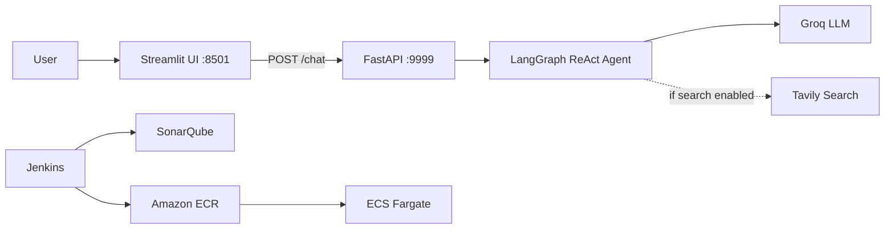

# Multi-Agent AI Application with LLMOps & AWS Deployment

End-to-end LLMOps project: a tool-using AI agent (LangGraph ReAct + Groq + optional Tavily search), a FastAPI backend, a Streamlit UI, Docker packaging, and a Jenkins pipeline that scans, builds, and deploys to Amazon ECS Fargate. 

## Architecture

# Workflow

